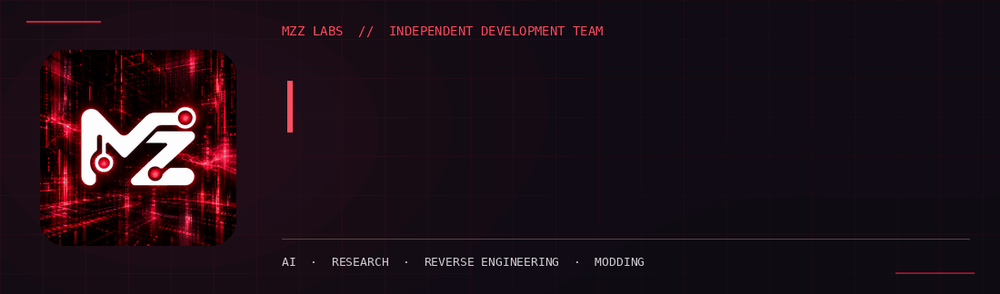
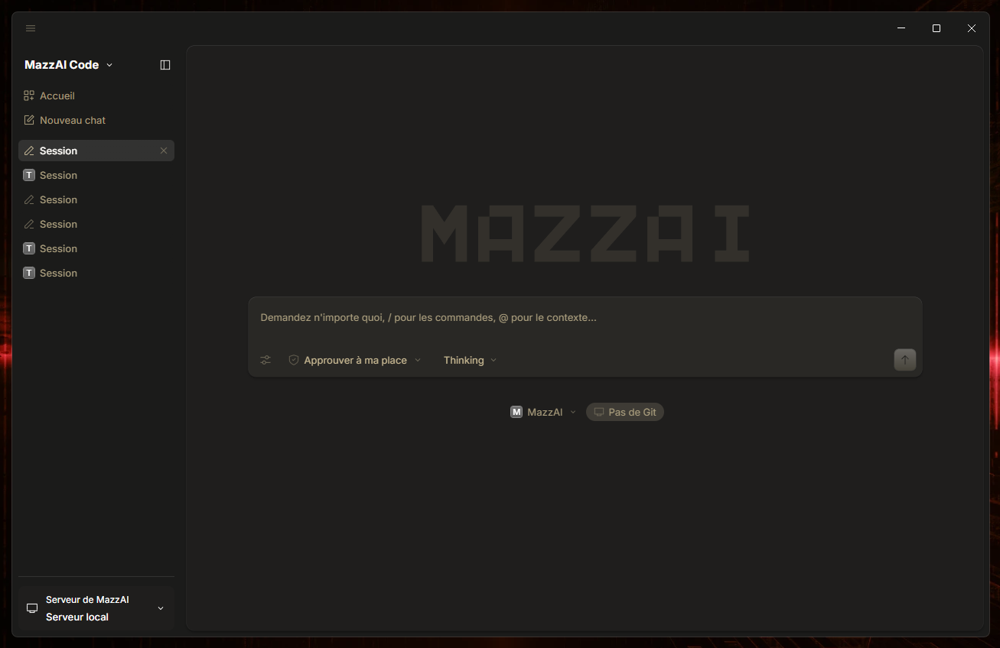

**Independent development team · AI engineering · Creative software**

We build intelligent tools, explore complex systems, and design digital experiences where powerful technology meets thoughtful interfaces.

## Mzz Labs

**Mzz Labs** is an independent development team focused on **artificial intelligence, software engineering, research and creative technology**. We approach development as both a practical discipline and a space for experimentation: understanding systems deeply, connecting different tools, and turning ambitious ideas into usable products.

Our interests span **AI harnesses, autonomous agents, orchestration, deep learning, full-stack and desktop applications, reverse engineering, automation, gaming and modding**. We care about the details behind the interface as much as the experience in front of it — from system behavior and interoperability to clear, carefully considered UI/UX.

Most of our projects are developed privately. This profile is a place to share our direction, selected product previews, and public work as it becomes ready.

### Areas of exploration

| Field | What we focus on |
| :--- | :--- |
| **AI & intelligent systems** | Harnesses, model inference, agent orchestration, deep learning, memory and context-aware workflows |
| **Software engineering** | Desktop and web applications, APIs, tooling, product design and developer experience |
| **Reverse engineering** | Software internals, architecture, compatibility, interoperability and technical research |
| **Automation & infrastructure** | Python tooling, connected services, browser automation, Linux, Windows and WSL2 |
| **Gaming & modding** | Game tools, mods, experimentation and interactive experiences |

## Featured project — MazzAI

**Harness-first AI ecosystem · Desktop workspace · Private development**

**MazzAI** is our evolving **AI harness and desktop workspace**: an environment built to bring conversations, AI agents, inference, persistent context and development tools together in one coherent experience.

The core idea is **more than chat**. MazzAI explores a system in which an assistant can help reason through a problem, coordinate specialized agents, use tools, preserve context and make complex execution understandable through a considered interface. Its design follows a **local-first** philosophy while leaving room for connected and hybrid workflows.

### Inside the ecosystem

| Pillar | Role |
| :--- | :--- |
| **Harness** | The central environment for coordinating execution, capabilities and workflows |
| **Chat** | Natural conversation, contextual assistance and supervised interaction |
| **Agents** | Delegation, sub-agents, task coordination and multi-session workflows |
| **Inference** | Model/provider integrations, reasoning and flexible inference options |
| **Memory** | Persistent context, long-running continuity and reusable knowledge |
| **Cloud** | Connected services and research into remote or hybrid environments |
| **Tooling** | Developer tools, terminal, browser automation and extensible integrations |

### Product experience

MazzAI currently brings together a **conversational workspace** and a **tool-enabled agentic experience**, with a focus on useful orchestration rather than a collection of isolated features. Work also includes clearer session navigation, agent observability, memory, integrated tooling and a desktop UI that keeps advanced workflows approachable.

The ecosystem is under active private development. Some capabilities and platform integrations are exploratory or planned rather than publicly available.

### Desktop preview

Actual MazzAI desktop interface · Work in progress · Design and capabilities may evolve.

## Engineering, research & creative work

We combine different technologies depending on the problem, with an emphasis on practical engineering, experimentation and maintainable interfaces.

**Languages & frameworks:** `Python` · `TypeScript` · `JavaScript` · `React` · `SolidJS` · `HTML/CSS` · `Tailwind CSS`

**Applications & systems:** `Electron` · `Node.js` · `Bun` · `Windows` · `Linux` · `WSL2` · `Git`

**AI & tooling:** `AI Harnesses` · `Agents` · `MCP` · `Model Inference` · `Memory` · `Automation`

**Research & creative:** `Reverse Engineering` · `Interoperability` · `UI/UX` · `Gaming` · `Modding`

### Currently exploring

- Building and refining the **MazzAI harness, desktop experience and agentic UX**.
- Improving **agent coordination, workflow observability, memory and tool integrations**.
- Researching **software architecture, reverse engineering and interoperability**.
- Experimenting with **automation, local-first systems, gaming tools and mods**.

Private-first development · Selected public previews · Mzz Labs

