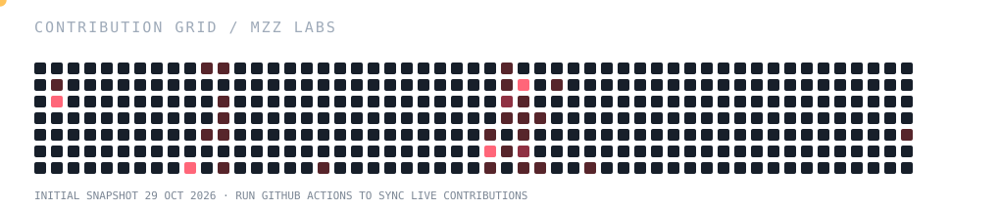
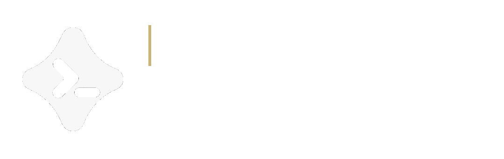
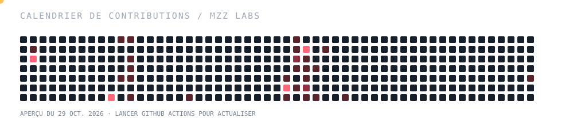

<!-- Mzz Labs GitHub Profile V9: English and French complete views in one README. -->
<!-- Native exclusive details groups, if GitHub preserves the grouping attribute. -->

<strong>🇬🇧 English · Default presentation</strong>

  
  
<strong>Independent development team · AI engineering · Creative software</strong>

  
Building intelligent tools and thoughtful digital experiences, from AI systems to creative engineering.

  

    
    
    
  

## Mzz Labs

**Mzz Labs** is an independent development team exploring and creating software at the intersection of **artificial intelligence, software engineering, technical research and creative technology**.

We connect hands-on research with practical product engineering: exploring how systems work, bringing technologies together and turning ambitious ideas into useful, carefully designed tools. Our work spans **agentic AI, inference and model tooling, automation, full-stack and desktop applications, reverse engineering, gaming and modding**. We care equally about capable software and interfaces people can understand. **AI agents assist across Mzz Labs projects**, supporting research, coding, debugging and repetitive workflows under human direction.

Many of our projects remain **private**. This profile shares our direction and selected product previews without exposing proprietary code or internal implementation details.

### Areas of focus

| Focus | What we work with |
|:--|:--|
| **Artificial intelligence** | AI harnesses, autonomous agents, orchestration, multi-provider inference, transformer models, deep learning and persistent context |
| **Software engineering** | Desktop and web apps, APIs, development tooling, architecture, UI/UX |
| **Reverse engineering** | Software internals, interoperability, compatibility analysis and systems research |
| **Automation & systems** | Python tooling, integrations, browser workflows, Windows, Linux, WSL2 and GPU-oriented experimentation |
| **Gaming & modding** | Game tools, mods, experimentation and interactive experiences |

## Featured project · MazzAI

  
  
<strong>Harness-first AI ecosystem · Desktop workspace · Private development</strong>

### Built on OpenCode. Designed with our own vision.

**MazzAI** is an independently developed **AI harness and desktop workspace** built on a customized foundation derived from the open-source **[OpenCode](https://github.com/anomalyco/opencode) codebase and agent architecture**. Rather than simply reskinning an existing tool, Mzz Labs is adapting and extending the foundation with its **own application components, interface, workflows and product direction**.

Our approach also draws inspiration from the agentic developer experience of **Claude Code** and **OpenAI Codex**. These are inspirations, not affiliations or endorsements: **MazzAI is an independent project** with its own design language and goals.

The aim is to make the entire AI workflow feel like one coherent environment: from a natural conversation to supervised tool use, multi-agent execution, persistent context and developer-oriented automation. The UI draws on modern, structured chat experiences, with richer responses, icons, visual elements and clear tool feedback.

### Inside the MazzAI ecosystem

| System | Capabilities and direction |
|:--|:--|
| **Harness & runtime** | OpenCode-derived agentic foundation, adapted execution flow, task coordination and MazzAI-specific extensions. |
| **Chat, Agent & Auto** | A dedicated conversational mode alongside tool-enabled agentic sessions and automated workflows. |
| **Build & Plan** | Task execution and implementation workflows, plus analysis, planning and review before changes. |
| **Rich conversational UI** | Structured responses, icons, visual components, tool feedback and a modern ChatGPT-inspired interaction model. |
| **Agents & sub-agents** | Delegation, nested tasks, multiple sessions, specialized agents and coordination between workflows. |
| **Session observability** | Agent activity tracking, execution visibility and a hierarchical visualization of sessions and delegations under development. |
| **Advanced permissions** | Granular tool approvals, supervised execution and configurable permission boundaries. |
| **Multi-provider inference** | Selection of hosted model APIs and compatible local runtimes, with interest in NVIDIA GPU acceleration, CUDA, Transformer-based tooling and model serving. Availability depends on the chosen provider and backend. |
| **Memory & context** | Conversation memory, cross-session continuity and customizable persistent context and knowledge. |
| **Developer tooling** | Terminal, browser, automation, MCP, computer-use capabilities and development workflows spanning Windows, Linux and WSL2. |
| **Local-first & connected** | A local-first workspace with connected services and hybrid/cloud workflows as an evolving direction. |

**Inference & compute:** Mzz Labs also explores local-model workflows using **Windows 11, Linux/WSL2, NVIDIA GPUs, CUDA and the Hugging Face Transformers ecosystem**, alongside hosted providers. These are technical focus areas; this does not imply every runtime or acceleration path is built into MazzAI today.

### Mobile ecosystem · Roadmap

MazzAI's long-term vision extends beyond desktop, with **Android and iOS companion applications** planned to connect to the wider workspace. For iOS, distribution through **sideloading tools such as SideStore** is being explored, rather than treated as an already shipping feature. **There is no public mobile release or guaranteed distribution method yet.**

**Development status:** MazzAI Desktop is in private development. Some features are usable or actively being integrated; others — especially advanced orchestration visualizations, selected cloud integrations and the mobile clients — are still in progress or planned. This is an ecosystem overview, not a public release feature checklist.

### Desktop preview · MazzAI Code

  
  
Real MazzAI desktop interface · Private work in progress · Design and features may evolve.

## Stack · full volume

Tools, languages and areas of interest — not a ranking or measured usage percentages.

<h4>Frontend &amp; UI</h4>

<h4>Backend &amp; automation</h4>

<h4>AI, inference &amp; agentic systems</h4>

<h4>Systems &amp; creative</h4>

## GitHub stats

<table>
<tr>
<td width="53%" valign="top">

</td>
<td width="47%" valign="top">

</td>
</tr>
</table>

Live external cards use public GitHub data and may be cached, limited or temporarily unavailable. Private code and offline work are not represented accurately by these numbers.

## Contribution snake

  
  
SVG animation generated from the public contribution grid. Run the included GitHub Action once to replace the initial snapshot with your current real activity.

Mzz Labs · Private-first development · Selected public previews

<strong>🇫🇷 Français · Lire la présentation complète</strong>

  
  
<strong>Équipe de développement indépendante · Ingénierie IA · Logiciels créatifs</strong>

  
Nous créons des outils intelligents et des expériences numériques soignées, des systèmes d'IA à l'ingénierie créative.

  

    
    
    
  

## Mzz Labs

**Mzz Labs** est une équipe de développement indépendante qui conçoit des logiciels à la rencontre de **l'intelligence artificielle, de l'ingénierie logicielle, de la recherche technique et de la création numérique**.

Nous relions recherche technique et développement concret : explorer le fonctionnement des systèmes, associer des technologies complémentaires et transformer des idées ambitieuses en outils utiles, avec une interface soignée. Nos travaux couvrent **l’IA agentique, l’inférence et les outils de modèles, l’automatisation, les applications web et desktop, la rétro-ingénierie, le jeu vidéo et le modding**. Nous accordons autant d’importance aux capacités des logiciels qu’à leur simplicité d’utilisation. **Des agents IA contribuent aux projets Mzz Labs**, sous supervision humaine, pour la recherche, le code, le débogage et les tâches répétitives.

La plupart de nos projets restent **privés**. Ce profil présente notre vision et quelques aperçus, sans exposer les codes sources ou les détails internes.

### Nos domaines d'activité

| Domaine | Ce que nous développons et étudions |
|:--|:--|
| **Intelligence artificielle** | Harness IA, agents autonomes, orchestration, inférence multi-fournisseurs, modèles Transformers, apprentissage profond et contexte persistant |
| **Ingénierie logicielle** | Applications desktop et web, API, outils de développement, architecture, UI/UX |
| **Rétro-ingénierie** | Fonctionnement interne des logiciels, interopérabilité, compatibilité et recherche sur les systèmes |
| **Automatisation et systèmes** | Outils Python, intégrations, automatisation du navigateur, Windows, Linux, WSL2 et expérimentations sur GPU |
| **Jeux vidéo et modding** | Outils liés aux jeux, mods, expérimentations et expériences interactives |

## Projet vedette · MazzAI

  
  
<strong>Écosystème IA centré sur le Harness · Application desktop · Développement privé</strong>

### Fondé sur OpenCode. Conçu selon notre propre vision.

**MazzAI** est un **harness IA et un espace de travail desktop indépendant**, fondé sur un socle personnalisé dérivé du **[code source open source et de l'architecture agentique d'OpenCode](https://github.com/anomalyco/opencode)**. Mzz Labs ne se limite pas à en modifier l'apparence : nous adaptons et enrichissons cette base avec **nos propres composants, notre interface, nos workflows et notre vision produit**.

Notre approche s'inspire également des expériences de développement agentique de **Claude Code** et d'**OpenAI Codex**, sans affiliation officielle avec ces produits. MazzAI possède sa propre identité graphique et ses propres objectifs.

Nous voulons réunir le parcours complet de l'IA dans un même environnement : conversation naturelle, utilisation supervisée des outils, exécution multi-agents, contexte persistant et automatisations pour le développement. L'interface s'inspire des expériences de conversation structurées modernes, avec des réponses enrichies, des icônes, des éléments visuels et des retours d'outils lisibles.

### Au cœur de l'écosystème MazzAI

| Système | Capacités et orientations |
|:--|:--|
| **Harness et moteur d'exécution** | Base agentique dérivée d'OpenCode, flux d'exécution adaptés, coordination des tâches et extensions propres à MazzAI. |
| **Chat, Agent et Auto** | Mode conversationnel distinct des sessions agentiques équipées d'outils et des workflows automatisés. |
| **Build et Plan** | Exécution et implémentation des tâches, analyse, planification et vérification avant modification. |
| **Interface conversationnelle enrichie** | Réponses structurées, icônes, composants visuels, retours d'outils et expérience inspirée des interfaces de chat modernes. |
| **Agents et sous-agents** | Délégation, tâches imbriquées, sessions multiples, agents spécialisés et coordination des workflows. |
| **Observabilité des sessions** | Suivi de l'activité agentique, visibilité sur l'exécution et visualisation hiérarchique des sessions et délégations en développement. |
| **Permissions avancées** | Autorisations granulaires des outils, exécution supervisée et limites de permission configurables. |
| **Inférence multi-fournisseurs** | Sélection d’API de modèles hébergés et de moteurs locaux compatibles, avec un intérêt pour l’accélération GPU NVIDIA, CUDA, les outils Transformers et le déploiement de modèles. Les possibilités dépendent du fournisseur et du moteur. |
| **Mémoire et contexte** | Mémoire des conversations, continuité entre sessions, connaissances et contexte persistant personnalisables. |
| **Outils de développement** | Terminal, navigateur, automatisation, MCP, Computer Use et workflows de développement sur Windows, Linux et WSL2. |
| **Priorité au local et connectivité** | Environnement local-first complété progressivement par des services connectés et des workflows hybrides ou cloud. |

**Inférence et calcul :** Mzz Labs explore également les modèles locaux avec **Windows 11, Linux/WSL2, les GPU NVIDIA, CUDA et l’écosystème Hugging Face Transformers**, en complément des fournisseurs hébergés. Ce sont des domaines techniques étudiés ; cela ne signifie pas que tous les moteurs et modes d’accélération sont déjà intégrés à MazzAI.

### Écosystème mobile · Feuille de route

À terme, MazzAI doit s'étendre au-delà du desktop avec des **applications complémentaires Android et iOS** reliées à l'espace de travail. Sur iOS, une distribution par des outils de *sideloading* comme **SideStore** est étudiée, sans être présentée comme une fonctionnalité déjà disponible. **Aucune version mobile publique ni méthode de distribution définitive n'est annoncée pour le moment.**

**État du développement :** MazzAI Desktop est développé en privé. Certaines capacités sont utilisables ou en cours d'intégration ; d'autres — notamment les visualisations avancées de l'orchestration, certaines intégrations cloud et les clients mobiles — sont encore prévues ou en développement. Cette présentation décrit l'écosystème, et non une liste de fonctions déjà publiées.

### Aperçu de l'application · MazzAI Code

  
  
Interface desktop réelle · Projet privé en cours de développement · Apparence et fonctionnalités susceptibles d'évoluer.

## Technologies et outils

Outils, langages et domaines d'intérêt — ni classement, ni pourcentages d'utilisation mesurés.

<h4>Interfaces et frontend</h4>

<h4>Backend et automatisation</h4>

<h4>IA, inférence et systèmes agentiques</h4>

<h4>Systèmes et création</h4>

## Statistiques GitHub

<table>
<tr>
<td width="53%" valign="top">

</td>
<td width="47%" valign="top">

</td>
</tr>
</table>

Ces cartes chargent des données GitHub publiques au moyen de services tiers. Elles peuvent être temporairement indisponibles ou différer des activités réalisées en privé et hors ligne.

## Serpent des contributions

  
  
Animation SVG générée à partir des contributions publiques. Le workflow GitHub Actions inclus peut la mettre à jour avec l'activité actuelle.

Mzz Labs · Développement privilégiant les projets privés · Aperçus publics sélectionnés

